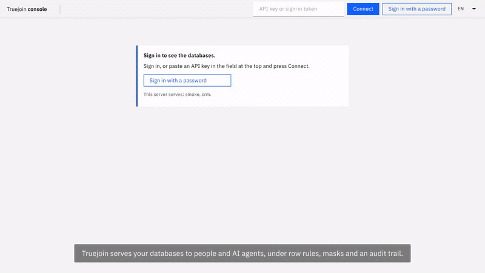
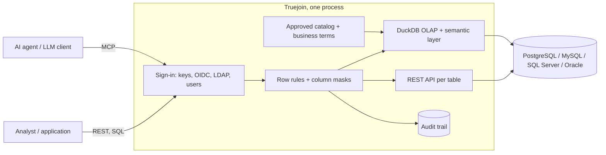
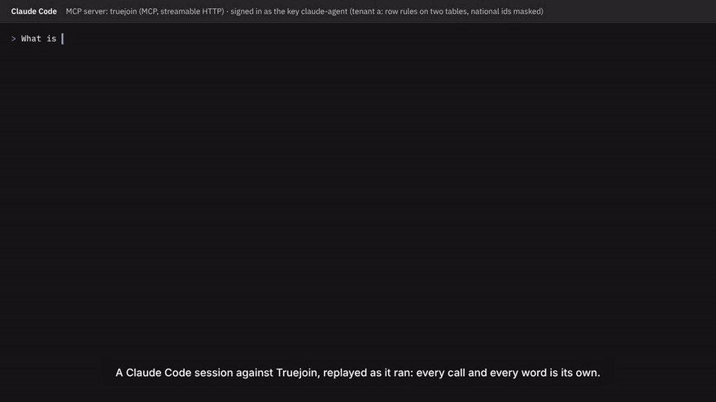

# Truejoin

**Governed access to corporate databases for AI agents and LLMs: an MCP server,
a REST API and in-memory OLAP over PostgreSQL, MySQL, SQL Server and Oracle,
with row-level security, column masking and an audit trail on every query.**

[](LICENSE)


Truejoin is an open-source data gateway that lets an AI agent (Claude, ChatGPT,
a local model on Ollama, or your own) read a company's relational databases
safely. It connects to the databases, has a language model draft a **data
catalog** that a person reviews and approves, and then serves the data through
**MCP tools**, a **REST/OpenAPI API** and an **analytical SQL endpoint** on
DuckDB. Every query, whether a person, a script or a model wrote it, runs
under the caller's row rules and column masks and leaves one audit event. It
runs as one process from one config file, on your own servers, without
internet access if need be.

[](docs/docs/assets/console-demo.mp4)

*The console, start to finish, in a minute and a half ([as a video to pause and seek](docs/docs/assets/console-demo.mp4)), and
[the same data read by Claude over MCP](#connect-an-ai-client-over-mcp).*

- [What it does](#what-it-does)
- [How it works](#how-it-works)
- [Quick start](#quick-start)
- [The console](#the-console)
- [Connect an AI client over MCP](#connect-an-ai-client-over-mcp)
- [Security and governance](#security-and-governance)
- [When to use it](#when-to-use-it)
- [FAQ](#faq)
- [Documentation](#documentation)
- [Türkçe özet](#türkçe-özet)

## What it does

| Capability | What you get |
|---|---|
| **MCP server for databases** | 18 tools for agents, among them `list_sources`, `describe_table`, `query_data`, `query_metrics`, `answer_question` and `search_terms`, over streamable HTTP (`/mcp`) or stdio |
| **Questions in words, without guessing** | `answer_question` reads a question against a reviewed business vocabulary, with no model at query time, and returns the request it understood and the SQL it compiled; a question the vocabulary cannot read goes to a model as SQL, marked as such, or is refused |
| **Reviewed data catalog** | Table and column descriptions, semantic types (PII labels), relationships and business terms, drafted by a model and used only after a person approves and certifies them |
| **Semantic layer** | Measures and dimensions per table; `query_metrics` joins along declared foreign keys, so a request cannot write a wrong join |
| **REST API per table** | Filtering, sorting, pagination, a typed OpenAPI schema enriched from the catalog, and streaming export (JSON, NDJSON, Arrow) |
| **In-memory OLAP** | DuckDB loads what a query needs; a table too big to load is read in slices, never in full |
| **Joins across databases** | One SQL statement can join tables of two connected databases, on different engines (a PostgreSQL and a MySQL, say); each caller's row rules and masks are applied to both before the join |
| **Row-level security and masking** | Row rules per caller and masks by semantic type, applied through joins, subqueries and CTEs |
| **Audit trail** | One append-only event per query: who, which table, how many rows, whether a rule or mask applied; never the SQL |
| **Sign-in** | API keys, OpenID Connect (Keycloak, Entra ID, Okta), LDAP (Active Directory, OpenLDAP, FreeIPA, lldap) and local users |
| **Web console** | Four screens (Query, Catalog, Administration, Docs) with a built-in user guide; in English and Turkish |
| **OpenAPI to MCP** | `truejoin mcp convert` turns an OpenAPI or Postman description into an MCP server definition |

Supported databases: **PostgreSQL**, **MySQL / MariaDB**, **Microsoft SQL
Server** and **Oracle** (the last two through ODBC). Model providers for the
catalog and the SQL fallback: **Ollama** (local), **OpenAI**, **Anthropic** and
**Google Gemini**.

## How it works



1. **Connect** the databases in `config/database.yaml` or from the console.
2. **Analyze**: a model drafts descriptions, PII labels, relationships and
   business terms (`truejoin catalog analyze`). Samples are masked before they
   reach the model, and go to a cloud model only if you allow it.
3. **Review and approve**: a person checks the draft and certifies it
   (`truejoin catalog review`, `approve`, `certify`). Nothing unapproved is used.
4. **Serve**: agents call the MCP tools, applications call REST, analysts write
   SQL. Each call runs under the caller's rules and is audited.

## Quick start

Requires Python 3.12+ and [uv](https://docs.astral.sh/uv/).

```bash
git clone https://github.com/yasinyaman/truejoin.git
cd truejoin
uv sync --all-extras

export TRUEJOIN_SECRET_KEY=$(uv run python -c 'from cryptography.fernet import Fernet; print(Fernet.generate_key().decode())')
uv run truejoin config validate -c config/database.yaml   # says what would stop the server
uv run truejoin users add yonetici --permission all -c config/database.yaml   # a first administrator
uv run truejoin serve -c config/database.yaml             # REST, /olap, /mcp and the console on :8000
```

The console is at `http://localhost:8000/ui`; its Docs screen opens on a user
guide.

To look at it on sample data first, with nothing but Docker:

```bash
docker compose -f scripts/demo/docker-compose.yml up --build -d --wait
```

It starts a PostgreSQL and a MySQL with made-up data beside the server, at the
same address; the sample keys to sign in with, and a report that joins the two
databases, are in [scripts/demo](scripts/demo/README.md). The videos here were
recorded on that setup.

For containers and Kubernetes:

```bash
make image          # the image; `make wheelhouse image-offline` builds it with no network
make smoke          # that image in production mode against a real PostgreSQL
helm install truejoin helm/truejoin -f my-values.yaml
```

## The console

`http://<host>:8000/ui`, in English and Turkish, light or dark with the system.
A caller is offered only what their sign-in may open, and every place in it has
an address to send someone to.

| Screen | What it is for |
|---|---|
| **Query** | SQL, or a question in words. The answer says how the question was understood, shows the SQL that ran, marks the columns masked for the caller and says when a join was corrected. |
| **Catalog** | Reviewing what a model drafted: descriptions, semantic types, relationships, business terms and measures. A text says who wrote it and what the last analysis changed; nothing is used until it is approved. |
| **Administration** | Databases (added without a restart; a failed connection says what to check), keys (row rules can be checked against the data before a key is handed out), users, the audit trail and usage, and settings applied at run time. |
| **Docs** | A user guide to all of the above, how to connect an MCP client, and this server's REST API with a form to try a route. |

## Connect an AI client over MCP

[](docs/docs/assets/claude-demo.mp4)

*A Claude Code session against the sample setup, replayed as it ran
([the whole of it](docs/docs/assets/claude-demo.mp4), and
[what it said and did](scripts/demo/claude-session.json)). The key belongs to
one tenant: Claude gets that tenant's rows with the national ids masked, says
so in its answer, and every read is in the audit trail under the key's name.*

Over HTTP, point any MCP client at `http://<host>:8000/mcp` with an API key in
`X-API-Key` or a bearer token:

```json
{
  "mcpServers": {
    "truejoin": {
      "type": "http",
      "url": "http://<host>:8000/mcp",
      "headers": { "X-API-Key": "<your API key>" }
    }
  }
}
```

For a desktop client such as Claude Desktop, run the tools over stdio:

```json
{
  "mcpServers": {
    "truejoin": {
      "command": "uv",
      "args": ["run", "--directory", "/path/to/truejoin", "truejoin", "serve",
               "--transport", "stdio", "-c", "config/database.yaml"]
    }
  }
}
```

The default `analyst` profile offers the read-only tools; `mcp.profile: admin`
adds the view and cache tools. With authentication on, a stdio session acts as
the key named in `mcp.stdio_api_key_name`. The same tools are exported as
OpenAI-style function definitions (`get_openai_tools()`).

## Security and governance

- **Production refuses an unsafe configuration**: authentication off, raw SQL
  on, a wildcard CORS origin, placeholder keys, plain `ldap://`, an identity
  provider without https, and more. The server says why and does not start.
- **SQL guardrails**: one read-only statement; writes and file or network
  functions are refused, and DuckDB runs with external access off.
- **Row rules and masks are applied by rewriting the query**, so aliases, joins
  and subqueries cannot read around them. This holds for SQL a model wrote as
  much as for a person's.
- **Model privacy**: sample values are masked before analysis and go to a cloud
  model only with `analysis.share_samples_with_cloud_llm`. With Ollama nothing
  leaves your network.
- **Secrets**: database passwords and settings added from the console are
  encrypted with a key from the environment; handed-out keys are kept as
  digests and user passwords as scrypt hashes.

See [SECURITY.md](SECURITY.md) and the [deployment guide](docs/docs/deployment.md).

## When to use it

Truejoin fits when:

- an AI assistant should answer questions over **production relational data**
  without being handed a database account;
- different people may see **different rows or columns** of the same table
  (tenants, regions, personal data);
- you need to show **who read what**, for KVKK, GDPR or an internal audit;
- the data must stay **on-premises**, Oracle and SQL Server included.

It is not a data warehouse, an ETL tool or a BI dashboard: it reads the
databases you already have, live, and serves what each caller may see.

## FAQ

**What is Truejoin?**
An open-source gateway that serves relational databases to AI agents over MCP,
REST and SQL, under row-level security, column masking and an audit trail,
after a person approves a catalog a model drafted.

**Is it a text-to-SQL tool?**
Partly. `answer_question` first reads a question against the reviewed business
vocabulary, with no model, and returns the request it understood and the SQL it
compiled. Only a question the vocabulary cannot read goes to a model to write
SQL (`olap.unread_questions: sql`, the default); that answer is marked as
written by a model and runs under the same rules.

**Does my data go to OpenAI or another cloud model?**
Not unless you choose one. With Ollama the model is local. With a cloud model,
catalog analysis sends masked samples only if
`analysis.share_samples_with_cloud_llm` is on, and the SQL fallback sends the
question and the schema the caller may see.

**Which databases does it support?**
PostgreSQL, MySQL and MariaDB natively; SQL Server and Oracle through ODBC.

**Which AI clients can use it?**
Any MCP client (Claude Desktop, Claude Code, IDE agents, your own agents) over
streamable HTTP or stdio, and any application over REST.

**Can it run without internet access?**
Yes. The image builds from a local wheelhouse (`make wheelhouse image-offline`),
and with a local model nothing calls out.

**Which languages can questions be asked in?**
The ones the catalog's terms are written in (`settings.i18n.languages`);
English and Turkish are used throughout the tests and the console.

**How is it licensed?**
Apache License 2.0.

## Documentation

The documentation site is **[yaman.dev/truejoin](https://yaman.dev/truejoin/)**.

| Topic | Where |
|---|---|
| Deploying, signing in, production checklist | [docs/docs/deployment.md](docs/docs/deployment.md) |
| Every setting | [docs/docs/configuration.md](docs/docs/configuration.md), [config/reference.yaml](config/reference.yaml) |
| Architecture (hexagonal, one process) | [docs/docs/architecture.md](docs/docs/architecture.md), [ADRs](docs/docs/adr/README.md) |
| Running a pilot on your own questions | [docs/docs/pilot.md](docs/docs/pilot.md) |
| Measures mined from the query history | [docs/docs/query-history.md](docs/docs/query-history.md) |
| The benchmark of the question-reading arms | [bench/README.md](bench/README.md) |
| OpenAPI to MCP examples | [examples/mcpgen/README.md](examples/mcpgen/README.md) |
| The sample setup and how the videos here are recorded | [scripts/demo/README.md](scripts/demo/README.md) |
| Changes | [CHANGELOG.md](CHANGELOG.md) |
| Contributing | [CONTRIBUTING.md](CONTRIBUTING.md) |
| A summary for language models | [llms.txt](llms.txt) |

Truejoin brings together three earlier projects: **Warp** (database to governed
REST with the catalog), **Fusion** (DuckDB OLAP and the agent tools) and
**Stargate** (OpenAPI to MCP). Their READMEs are kept under
[docs/origins/](docs/origins/).

**Status:** 1.0.0 is in development and not yet on PyPI; install from source.

## Türkçe özet

Truejoin, şirket veritabanlarını (PostgreSQL, MySQL, SQL Server, Oracle) yapay
zekâ ajanlarına ve dil modellerine **güvenli** biçimde açan açık kaynaklı bir
veri geçididir. Bir dil modeli veri kataloğunu (tablo ve sütun açıklamaları,
kişisel veri etiketleri, iş terimleri) taslak olarak yazar, bir kişi onaylar;
ardından veri **MCP araçları**, **REST API** ve **DuckDB üzerinde analitik SQL**
ile sunulur. Her sorgu, kimin yazdığından bağımsız olarak çağıranın **satır
kuralları** ve **sütun maskeleri** altında çalışır ve bir **denetim kaydı**
bırakır. Türkçe sorular onaylı sözlükle, sorgu anında model kullanılmadan
okunur. Konsol Türkçedir: dört ekranı (Sorgu, Katalog, Yönetim, Belgeler) ve
içinde bir kullanma kılavuzu vardır. Kendi sunucunuzda, gerekirse internetsiz çalışır ve
KVKK denetiminde kimin neyi okuduğunu gösterir. Lisans: Apache 2.0.

## License

[Apache License 2.0](LICENSE). To cite it, see [CITATION.cff](CITATION.cff).
